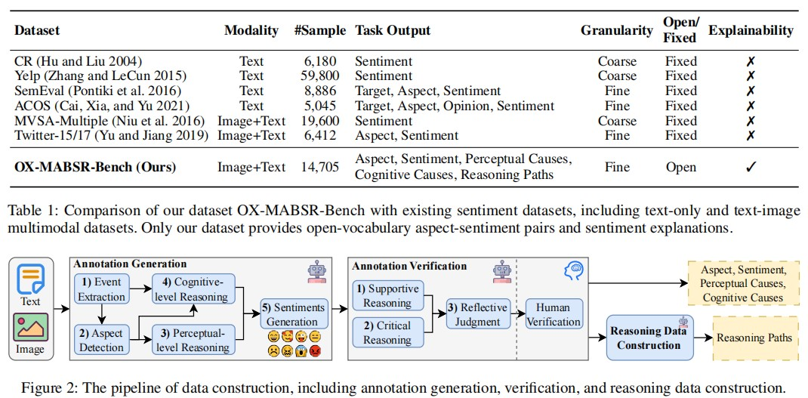
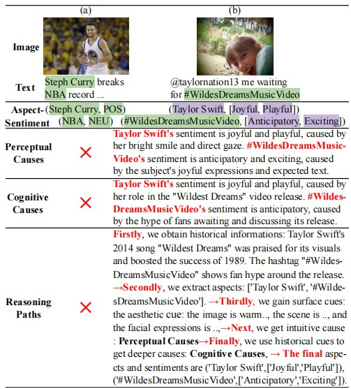

# OX-MABSR

**OX-MABSR: A Benchmark for Open-domain Explainable Multimodal Aspect-Based Sentiment Reasoning**

*Published at AAAI 2026*

## 🌐 Live Demo

A modern web frontend is available in the [`frontend/`](./frontend/) directory. It provides an interactive interface for exploring the OX-MABSR benchmark with:

- **Landing Page** — Overview of capabilities and benchmark statistics
- **Interactive Demo** — Upload images and text for sentiment analysis
- **About Page** — Paper details, methodology, and citation

### Running the Frontend

```bash
cd frontend
npm install
npm run dev
```

For more details, see the [Frontend README](./frontend/README.md).

---

## 📊 Data Link

[Download Dataset from Google Drive](https://drive.google.com/drive/folders/1ayN8fIQF1aLegnNIVM8pFiegRI8BQKMo?usp=sharing)

## 📁 Data





## 📁 Code Structure

```
CODE/
├── train.py              # Main training script
├── train_cot.py          # Chain-of-Thought training
├── train_grpo.py         # GRPO-based training
├── inference.py          # Inference script
├── qwen3_vl.py           # Qwen3-VL model architecture
├── mydataset.py          # Dataset loading utilities
├── eval_*.py             # Evaluation scripts (BLEU, ROUGE, LLM)
└── *.py                  # Additional utilities
```

## 🚀 Quick Start

```bash
# Install dependencies
pip install torch transformers peft numpy

# Run inference
python CODE/inference.py

# Train model
python CODE/train.py
```

## 📚 Citation

```bibtex
@inproceedings{liu2026oxmabsr,
  title={OX-MABSR: A Benchmark for Open-domain Explainable Multimodal Aspect-Based Sentiment Reasoning},
  author={Liu, X.J. and Anya},
  booktitle={Proceedings of the AAAI Conference on Artificial Intelligence},
  year={2026}
}
```

## 🔗 Links

- [📄 Paper PDF](./paper.pdf)
- [📊 Dataset](https://drive.google.com/drive/folders/1ayN8fIQF1aLegnNIVM8pFiegRI8BQKMo?usp=sharing)
- [🌐 Frontend Demo](./frontend/)
